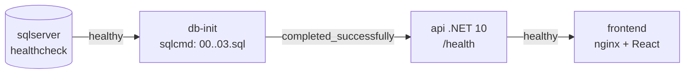
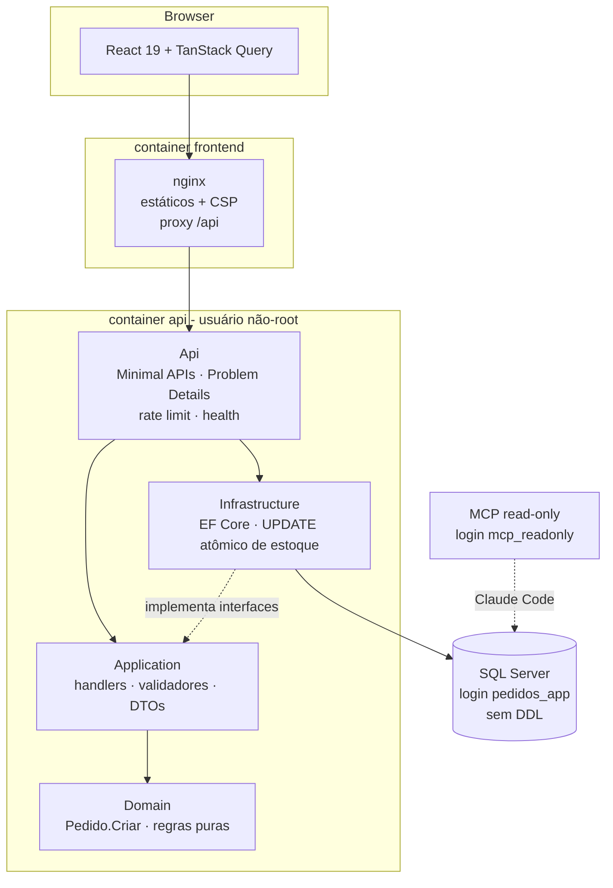
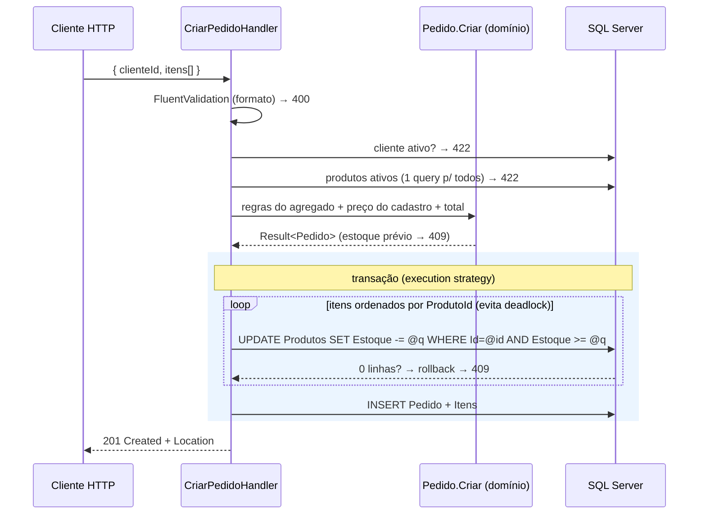

# Mini Gestão de Pedidos

Cadastro e consulta de pedidos de clientes — **.NET 10 + EF Core + SQL Server + React 19/TypeScript** —
desenvolvido com **Claude Code** em fluxo *Spec-Driven Development* (SDD).

[](https://github.com/Will0410/mini-gestao-pedidos/actions/workflows/ci.yml)

| Documento | Conteúdo |
|---|---|
| [`docs/spec.md`](docs/spec.md) | Especificação: regras (`RN-xx`), endpoints, modelo de dados, critérios de aceite (`CA-xx`) |
| [`docs/plan.md`](docs/plan.md) | Plano do plan mode + o que ajustei/discordei e por quê (+ desvios durante a execução) |
| [`CLAUDE.md`](CLAUDE.md) | Regras do projeto para o Claude (arquitetura, nomenclatura, comandos) |
| [`.claude/`](.claude) | Hooks, skills, subagente revisor · [`.mcp.json`](.mcp.json) → MCP do SQL Server |

---

## Sumário

1. [Como rodar com Docker](#1-como-rodar-com-docker)
2. [Como rodar os testes](#2-como-rodar-os-testes)
3. [Arquitetura](#3-arquitetura)
4. [Principais decisões técnicas](#4-principais-decisões-técnicas)
5. [Segurança](#5-segurança)
6. [Performance e teste de carga](#6-performance-e-teste-de-carga)
7. [Parte 4 — Debug da query](#7-parte-4--debug-da-query)
8. [Como usei o Claude Code](#8-como-usei-o-claude-code)
9. [Limitações e próximos passos](#9-limitações-e-próximos-passos)

---

## 1. Como rodar com Docker

Pré-requisito: Docker (Desktop ou Engine) com Compose v2.

```bash
docker compose up --build
```

Pronto. Nenhum passo manual: o compose sobe o SQL Server, espera ele ficar saudável, roda os scripts de
`database/init/` (schema, carga de exemplo e logins), sobe a API e por fim o frontend.

| Serviço | URL |
|---|---|
| **Frontend** | http://localhost:8080 |
| API (Swagger) | http://localhost:5080/swagger |
| API via proxy do front | http://localhost:8080/api/pedidos |
| SQL Server | `localhost,14333` — `sa` / `Pedidos@Local2026!` |



- **Senhas**: os padrões servem só para avaliação local. Para trocar, copie `.env.example` para `.env`.
- **Portas ocupadas?** Ajuste `FRONTEND_PORT`, `API_PORT`, `SQL_PORT` no `.env`.
- **Mac Apple Silicon**: a imagem do SQL Server é amd64; o compose já declara `platform: linux/amd64`
  (ative *Rosetta* no Docker Desktop).
- **Recomeçar do zero** (apaga o banco): `docker compose down -v && docker compose up --build`.

Dados de exemplo: 25 clientes (incluindo 2 homônimos "Maria Silva", 1 inativo e 1 sem compras),
30 produtos (1 com estoque 3, 1 inativo) e **20.000 pedidos / 50.000 itens** entre 2025 e 2026,
gerados de forma determinística (mesmos dados em toda máquina).

## 2. Como rodar os testes

| Suíte | Comando | O que cobre |
|---|---|---|
| **Unitários** (48) | `cd backend && dotnet test --project tests/Pedidos.UnitTests` | Domínio, validadores e handler com fakes em memória: cliente inexistente/inativo, produto inexistente, estoque insuficiente (com rollback), pedido sem itens, quantidade inválida, produto repetido, preço não vem do cliente, corrida de estoque, limites de paginação/data |
| **Integração** (30) | `cd backend && dotnet test --project tests/Pedidos.IntegrationTests` | Endpoints reais (`WebApplicationFactory`) contra **SQL Server real** via **Testcontainers**, aplicando os mesmos scripts de `database/init` e conectando com o login de menor privilégio. Inclui **20 pedidos concorrentes** para um produto com estoque 5 → exatamente 5 sucessos |
| Backend sem SDK local | `./scripts/test-backend-docker.sh` | As duas suítes acima dentro de um container do SDK, usando o SQL Server do compose |
| Frontend (18) | `cd frontend && npm ci && npm test` | Validação do formulário, cálculo do total, filtros na URL, modal (Testing Library) |
| **E2E** (4) | `docker compose up -d --build` e `cd frontend && npx playwright install chromium && npx playwright test` | Criar pedido no modal e vê-lo no topo da listagem (CA-14), filtro por cliente na URL, validação, ranking |
| MCP | `cd tools/mcp-sqlserver && npm ci && npm test` (e `npm run smoke` com o banco no ar) | Validação somente leitura e resumo do plano de execução |
| Carga | `docker run --rm -i --network pedidos_default -e BASE_URL=http://api:8080 grafana/k6:2.4.0 run - < tests/load/pedidos.k6.js` | 50 VUs + escrita concorrente, thresholds de latência |

Integração com o SQL Server do compose em vez de Testcontainers:
`INTEGRATION_SQL_SERVER=localhost,14333 dotnet test --project tests/Pedidos.IntegrationTests`.

Rastreabilidade: cada teste cita o critério de aceite que cobre (`// CA-07 / RN-10`).
O **CI** ([`.github/workflows/ci.yml`](.github/workflows/ci.yml)) roda tudo isso a cada push/PR, inclusive
`docker compose up --wait` + Playwright + um smoke de carga k6.

## 3. Arquitetura



```
database/init/      00-database · 01-schema · 02-seed · 03-logins  (fonte da verdade do schema)
database/queries/   Parte 4: query corrigida + benchmark
backend/src/        Pedidos.Domain · .Application · .Infrastructure · .Api
backend/tests/      Pedidos.UnitTests · Pedidos.IntegrationTests
frontend/           src/api (cliente tipado) · src/features/pedidos · e2e/ (Playwright)
tools/mcp-sqlserver MCP somente leitura
tests/load/         k6
.claude/            settings.json (hooks) · hooks/ · skills/ · agents/
```

**Fluxo do `POST /pedidos`** (o coração da regra de negócio):



## 4. Principais decisões técnicas

| Decisão | Alternativa descartada | Motivo |
|---|---|---|
| **.NET 10 LTS** | .NET 8 | O suporte do .NET 8 terminou em 10/11/2026. |
| **Baixa de estoque por `UPDATE ... WHERE Estoque >= @q`** checando linhas afetadas | Ler → comparar → `SaveChanges` | Ler-e-depois-gravar tem *race condition* (duas requisições veem estoque 1 e vendem 2). O UPDATE condicional é atômico. Provado pelo teste de 20 requisições paralelas. `CHECK (Estoque >= 0)` no banco é a última barreira. |
| **Schema em scripts SQL**; EF só mapeia | EF Migrations | Requisito do teste + uma única fonte de schema + índices com `INCLUDE` explícitos. |
| **Result pattern** com `code` estável | Exceções para regra de negócio | Erro de negócio não é excepcional; o frontend trata `ESTOQUE_INSUFICIENTE` etc. pelo código. |
| **400 / 422 / 409** | Tudo 400 | 400 = contrato inválido; 422 = referência inexistente; 409 = conflito com o estado atual (estoque), que pode mudar se repetido. |
| **Preço sempre do cadastro** | Aceitar `precoUnitario` do cliente | Evita adulteração de preço; testado enviando preço falso. |
| **`ValorTotal` desnormalizado** em `Pedidos` | Somar itens em toda consulta | Pedidos são imutáveis; listagem e relatório leem um índice de cobertura. A consistência com os itens é verificada em teste. |
| **Clean Architecture enxuta** (4 projetos) | Projeto único | Regras testáveis sem banco; Domain sem dependências. |
| **Minimal APIs** | Controllers | Menos cerimônia; padrão de endpoint replicável pela skill. |
| **Testcontainers + scripts reais** | EF InMemory | InMemory não tem transação, constraint nem lock — não testaria o que importa. |
| **nginx com proxy `/api`** | `vite preview` / CORS aberto | Servidor de produção, sem CORS no navegador, com CSP e headers de segurança. |
| **Filtros na URL** | Estado só em memória | Link compartilhável e botão "voltar" funcionam. |
| **`READ_COMMITTED_SNAPSHOT`** | Padrão do SQL Server | Listagem e relatório não bloqueiam (nem são bloqueados) pelas escritas. |
| **Datas em UTC, `DATETIME2(0)`** | Hora local | Sem ambiguidade de fuso; o front exibe no fuso do navegador. A data é truncada em segundos no domínio porque `DATETIME2(0)` **arredonda** (sem isso o POST e o GET divergiam em até 1s). |

**Sobre RAG/LLM**: avaliei, mas não há caso de uso no domínio pedido (cadastro/consulta transacional).
Colocar um LLM no caminho de criação de pedidos acrescentaria custo, latência e não-determinismo sem valor
para o usuário. O "AI First" aqui está no **processo de desenvolvimento** (seção 8).

## 5. Segurança

| Ameaça | Mitigação |
|---|---|
| SQL injection | Só EF Core/consultas parametrizadas; zero SQL concatenado. |
| Adulteração de preço/total | Preço e total calculados no servidor (RN-07/08). |
| Venda acima do estoque sob concorrência | UPDATE condicional atômico + `CHECK` no banco + ordem fixa de locks. |
| Abuso / DoS de aplicação | Rate limit por IP no POST (100/10s), corpo máx. 64 KB, `pageSize ≤ 100`, `page ≤ 100.000`, período do relatório ≤ 5 anos, datas entre 2000–2100. |
| Falsificar IP para burlar o rate limit | `ForwardedHeaders` só confia em `X-Forwarded-For` vindo da rede interna do docker (testado: 130 POSTs com XFF falso → 30 recebem 429). |
| Vazamento de detalhes internos | Problem Details sem stack trace fora de Development (teste com JSON malformado). |
| Privilégio excessivo no banco | API usa `pedidos_app` (só leitura/escrita de dados, **sem DDL**); MCP usa `mcp_readonly` com `db_denydatawriter`. Ninguém usa `sa` em runtime. |
| Agente de IA destrutivo | Hook `guard.mjs` bloqueia `DROP`, `reset --hard`, push forçado, edição de `.env`; MCP somente leitura em 3 camadas. |
| XSS / clickjacking | React escapa por padrão; CSP restritiva, `X-Frame-Options: DENY`, `nosniff`, `Referrer-Policy`. |
| Container | API roda como usuário não-root (`app`, uid 1654); imagem final sem SDK/node. |
| Dependências e código | Dependabot com política LTS, CodeQL (C# e TypeScript), secret scanning com push protection; CI falha com pacote NuGet High/Critical e com `npm audit` de produção ≥ high. Hoje: **0 vulnerabilidades** (produção e desenvolvimento). |

**Achados da minha revisão de segurança** (cada um reproduzido por teste antes de corrigir — commit `fix(security)`):
1. O rate limit "por IP" usava o IP do nginx → virava um limite **global** para todos os usuários.
2. `?page=2147483647` estourava o cálculo do offset → **500**.
3. `?dataFim=9999-12-31` estourava `DateOnly.AddDays(1)` → **500**.
4. **CodeQL** (`cs/log-forging`, médio): `Request.Path` e a mensagem da exceção iam para o log sem sanitização — um path com `
` forjaria linhas falsas no log. Quebras de linha agora são removidas (teste em `Seguranca/LogForgingTests.cs`).

Riscos aceitos (contexto de avaliação local): sem autenticação (fora de escopo na spec), Swagger habilitado e
porta da API publicada para facilitar a avaliação, senhas padrão no compose. Em produção: API privada atrás do
proxy, segredos em cofre, Swagger desligado, autenticação (JWT/OIDC).

## 6. Performance e teste de carga

k6, 70 s, rampa até **50 usuários** na listagem/relatório + **5 pedidos/s** concorrentes, base com 20 mil pedidos
([`tests/load/pedidos.k6.js`](tests/load/pedidos.k6.js)):

| Métrica | Resultado | Meta |
|---|---|---|
| `GET /pedidos` p95 | **31 ms** | < 200 ms (RNF-02) ✅ |
| `GET /relatorios/top-clientes` p95 | **18 ms** | < 300 ms ✅ |
| `POST /pedidos` p95 | **83 ms** | < 300 ms ✅ |
| Erros | **0 de 13.247** requisições | < 1 % ✅ |
| Vazão | ~189 req/s | — |

O que sustenta esses números: índices de cobertura (`IX_Pedidos_DataPedido INCLUDE (ClienteId, ValorTotal)`),
filtros sargáveis, `AsNoTracking` + projeção direta para DTO, uma query para todos os produtos do pedido (sem N+1)
e RCSI evitando bloqueio leitura × escrita.

## 7. Parte 4 — Debug da query

Query recebida:

```sql
SELECT c.Nome, SUM(i.Quantidade * i.PrecoUnitario) AS Total
FROM Clientes c
LEFT JOIN Pedidos p ON p.ClienteId = c.Id
LEFT JOIN ItensPedido i ON i.PedidoId = p.Id
WHERE YEAR(p.DataPedido) = 2026
GROUP BY c.Nome
ORDER BY Total
```

### 7.1 Como investiguei

1. **Reescrevi a intenção em uma frase**: "clientes ordenados do que mais comprou para o que menos comprou em 2026".
   Divergência entre intenção e SQL é bug de corretude — vem antes de performance.
2. **Conferi o schema real pelo MCP** (`describe_table`): `Clientes.Nome` não é único; as FKs têm índice.
3. **Provei os bugs com dados**: o seed tem, de propósito, dois clientes chamados "Maria Silva" (ids 1 e 2).
   Rodei original × corrigida com os mesmos dados ([`database/queries/parte4-benchmark.sql`](database/queries/parte4-benchmark.sql)).
4. **Plano de execução** (`explain` do MCP / `SHOWPLAN_TEXT`) e **`SET STATISTICS IO, TIME ON`** para medir páginas lidas e CPU.
5. Variei o período (ano × mês) para separar o efeito da sargabilidade do efeito do volume.

Para reproduzir: `./scripts/parte4-benchmark.sh`.

### 7.2 O que estava errado

| # | Problema | Efeito observado | Correção |
|---|---|---|---|
| 1 | `ORDER BY Total` é **ascendente** | O "ranking" saía invertido: quem menos comprou aparecia primeiro | `ORDER BY Total DESC, c.Id` (desempate determinístico) + `RANK()` |
| 2 | `GROUP BY c.Nome` | **Homônimos somados como um só cliente**: "Maria Silva" aparecia com R$ 15.249.874,10 (= 8.568.037,90 + 6.681.836,20 de duas pessoas). 21 linhas em vez de 22 | `GROUP BY c.Id, c.Nome` |
| 3 | `LEFT JOIN` + filtro em `p` no `WHERE` | O `WHERE YEAR(p.DataPedido) = 2026` descarta as linhas com `p` nulo → o LEFT JOIN vira INNER na prática; a query **parece** incluir clientes sem compra mas não inclui. Intenção ambígua | `INNER JOIN` explícito (ranking de quem comprou). Se o negócio quiser todos com 0, o filtro vai para o `ON` + `COALESCE` (variante no script) |
| 4 | `YEAR(p.DataPedido) = 2026` é **não-sargável** | A função sobre a coluna impede *Index Seek*: o plano faz **Index Scan completo** de Pedidos com `YEAR()` como predicado residual, independentemente do período | `p.DataPedido >= '2026-01-01' AND p.DataPedido < '2027-01-01'` (semiaberto: pega 31/12 23:59:59 sem gambiarra) |
| 5 | Índices | Sem índice em `Pedidos(DataPedido)` e nas FKs, todo filtro/join vira scan | `IX_Pedidos_DataPedido (DataPedido) INCLUDE (ClienteId, ValorTotal)`, `UX_ItensPedido_PedidoId_ProdutoId INCLUDE (Quantidade, PrecoUnitario)`, `IX_Pedidos_ClienteId_DataPedido` |

### 7.3 Query corrigida

```sql
SELECT
    RANK() OVER (ORDER BY SUM(i.Quantidade * i.PrecoUnitario) DESC) AS Posicao,
    c.Id                                AS ClienteId,
    c.Nome,
    COUNT(DISTINCT p.Id)                AS QtdPedidos,
    SUM(i.Quantidade * i.PrecoUnitario) AS Total
FROM dbo.Pedidos p
INNER JOIN dbo.ItensPedido i ON i.PedidoId = p.Id
INNER JOIN dbo.Clientes c    ON c.Id = p.ClienteId
WHERE p.DataPedido >= '2026-01-01'
  AND p.DataPedido <  '2027-01-01'
GROUP BY c.Id, c.Nome
ORDER BY Total DESC, c.Id;
```

### 7.4 Medições (20 mil pedidos, 50 mil itens, cache quente)

| Cenário | Acesso a `Pedidos` | Páginas lidas `Pedidos` | Páginas `ItensPedido` | CPU |
|---|---|---|---|---|
| Original — ano 2026 | Index Scan + `YEAR()` residual | 110 | 300 | 112 ms |
| Corrigida — ano 2026 | **Index Seek** `IX_Pedidos_DataPedido` | **52** | 300 | 88 ms |
| Original — só out/2026 (`YEAR`+`MONTH`) | Index Scan | 110 | 300 | 16 ms |
| Corrigida — só out/2026 | **Index Seek** | **8** (−93 %) | 300 | 8 ms |
| Variante da API (`SUM(ValorTotal)`, TOP 5) | Index Seek, cobertura | **52** | **0** | **4 ms** (−96 %) |

**Leitura crítica dos números** (não quero vender mais do que os dados mostram):
- Para o **ano inteiro**, 2026 representa ~47 % da base, então Seek × Scan muda pouco (110 → 52 páginas).
  A sargabilidade brilha em **períodos curtos**: num mês, 110 → 8 páginas — e a original lê sempre a tabela toda,
  piorando linearmente com o crescimento da base.
- `ItensPedido` continua sendo varrido (300 páginas) mesmo com o índice: com ~45 % dos itens no período, o
  otimizador corretamente prefere um *scan* + *hash join* a milhares de *seeks*. Forçar o índice seria pior.
- O maior ganho vem de **não precisar ler os itens**: como pedidos são imutáveis, `Pedidos.ValorTotal` já tem a
  soma, e o endpoint `GET /relatorios/top-clientes` lê só o índice de cobertura (4 ms de CPU, 0 páginas de itens).
- Com o volume do seed tudo é rápido em termos absolutos; o que importa é a **tendência**: a original é O(tabela)
  sempre; a corrigida é O(período).

## 8. Como usei o Claude Code

### 8.1 Estrutura AI First no repositório

| Peça | Onde | Para quê |
|---|---|---|
| **Rules** | [`CLAUDE.md`](CLAUDE.md) | Arquitetura e dependências permitidas entre camadas, nomenclatura (domínio em PT, técnico em EN), padrões obrigatórios (Result, `AsNoTracking`, baixa atômica, UTC), comandos de build/teste e uma lista de "não faça". |
| **Hook PostToolUse** | [`.claude/hooks/post-edit-check.mjs`](.claude/hooks/post-edit-check.mjs) | Após cada edição de `.cs`/`.csproj` roda `dotnet build`; após `.ts/.tsx`, `npm run typecheck`. Erro volta para o Claude (exit 2), que corrige na hora. |
| **Hook PreToolUse** | [`.claude/hooks/guard.mjs`](.claude/hooks/guard.mjs) | Bloqueia `git push --force`, `reset --hard`, `rebase`, `--amend` (o teste pede histórico preservado), `DROP/TRUNCATE`, `rm -rf` perigoso e edição de `.env`. |
| **Skill** `new-endpoint` | [`.claude/skills/new-endpoint`](.claude/skills/new-endpoint/SKILL.md) | Receita do endpoint ponta a ponta: spec → contrato → validador → handler/query → endpoint → testes unit/integração → tipo no front. |
| **Skill** `sql-query-review` | [`.claude/skills/sql-query-review`](.claude/skills/sql-query-review/SKILL.md) | Checklist de corretude e performance de T-SQL usando o MCP (schema real, `explain`, prova com dados). Foi o roteiro da Parte 4. |
| **Subagente** `code-reviewer` | [`.claude/agents/code-reviewer.md`](.claude/agents/code-reviewer.md) | Revisão crítica do diff (spec, concorrência, segurança, arquitetura, testes fracos). |
| **MCP** `sqlserver` | [`.mcp.json`](.mcp.json) → [`tools/mcp-sqlserver`](tools/mcp-sqlserver) | Conexão do Claude ao SQL Server, **somente leitura**. |

### 8.2 Como o MCP foi usado durante o desenvolvimento

Escrevi um MCP próprio (~200 linhas, SDK oficial) em vez de usar um da comunidade com `sa` — dar acesso de
escrita a um agente é um risco real. Ferramentas: `list_tables`, `describe_table`, `query`, `explain`.
Proteção em 3 camadas: validação (só `SELECT`/`WITH`, um statement), transação sempre revertida e login
`mcp_readonly` com `db_denydatawriter` (verifiquei: `UPDATE` → *permission denied*).

Usos concretos:
- **Validar os scripts**: depois de rodar `01-schema.sql`, `describe_table ItensPedido` confirmou chaves, `INCLUDE`
  dos índices e FKs; `list_tables` confirmou o volume do seed (20.000 / 50.000).
- **Desenhar o seed para a Parte 4**: `query` confirmou os dois "Maria Silva" com e-mails distintos.
- **Diagnosticar a Parte 4**: `explain` da versão com `YEAR()` devolveu `Index Scan` em
  `IX_Pedidos_ClienteId_DataPedido` — foi o ponto de partida da investigação.
- **Conferir efeitos dos testes**: estoque e pedidos gravados após os cenários de concorrência.

Para usar: suba o banco (`docker compose up -d sqlserver db-init`), `cd tools/mcp-sqlserver && npm ci`, abra o
Claude Code na raiz e rode `/mcp` — `sqlserver` aparece conectado.

### 8.3 Fluxo de trabalho

1. **Spec primeiro** (`docs/spec.md`) com regras e critérios de aceite numerados.
2. **Plan mode** para o plano; revisei e registrei 12 discordâncias antes de codar ([`docs/plan.md`](docs/plan.md) §2)
   — as mais importantes: race condition na baixa de estoque, InMemory nos testes de integração e MCP com `sa`.
3. Implementação em **camadas, um commit por etapa**, com o hook compilando a cada edição.
4. **Testes referenciando `CA-xx`**; bugs encontrados viraram testes antes da correção.
5. **Revisão de segurança** dedicada no fim, que encontrou 3 falhas (seção 5).

### 8.4 O que funcionou bem

- **Hook de build**: erros de compilação apareciam e eram corrigidos na mesma interação, sem acumular.
- **Hook guard**: bloqueou na prática um comando com `git push --force` (o próprio texto de um teste do hook) —
  prova de que o hook está ativo.
- **Spec com IDs** tornou trivial cobrar cobertura: "qual teste cobre o CA-07?".
- **Testes de integração com banco real** pegaram bugs que mock nenhum pegaria (abaixo).
- Geração de boilerplate (DTOs, mapeamentos, configuração de Docker/CI) com revisão rápida.

### 8.5 O que precisei corrigir no código gerado

Registro honesto do que **não** saiu certo de primeira — e como foi pego:

| Problema no código gerado | Como foi detectado | Correção |
|---|---|---|
| Plano inicial fazia "ler estoque → comparar → salvar" (race condition) | Revisão do plan mode | UPDATE condicional atômico + teste de 20 requisições paralelas |
| `GET /pedidos/{id}` dava **500**: `OrderBy` depois de projetar para record não é traduzível pelo EF | Teste de integração (o smoke manual não cobria a rota) | Ordenar antes da projeção |
| Validador lançava `NullReferenceException` com item `null` no array | Teste unitário de borda | `Cascade(Stop)` + regra "nenhum item nulo" |
| Regex do resumo do plano no MCP nunca capturava o índice (quantificador preguiçoso + grupo opcional) | Teste unitário do MCP | Parse dos atributos por tag |
| `PRINT CONCAT((SELECT COUNT(*)...))` no seed — T-SQL não aceita subquery no `PRINT` | Execução do `db-init` | Variáveis antes do `PRINT` |
| Data do pedido divergia em até 1 s entre POST e GET (`DATETIME2(0)` arredonda) | Smoke manual comparando respostas | Truncar para segundos no domínio |
| nginx reescrevia `Location` sem a porta (`http://localhost/api/...`) | Inspeção dos headers no teste do compose | `absolute_redirect off` + `Host $http_host` |
| Teste E2E com um "helper" placeholder que não fazia nada (`optionIndex`) | Revisão do código antes de rodar | Helper real que seleciona por texto parcial |
| Rate limit ineficaz atrás do proxy; overflow de `page` e de data | Revisão de segurança | Seção 5 |
| Hook de build com mensagem vazia (dotnet fora do PATH do processo) | O próprio hook disparando na sessão | Hook localiza o dotnet e ignora solução vazia |
| `CLAUDE.md`/skill citavam arquivos e comandos que mudaram na implementação | Revisão final | Atualizados — regras desatualizadas induzem o agente a erro |

Lição principal: o código gerado **compila e parece certo** com muita facilidade. O que separa "parece" de "está"
foram os testes contra banco real, a leitura crítica do plano e uma revisão de segurança feita de propósito.

### 8.6 Ambiente

O Windows Application Control do ambiente de desenvolvimento bloqueou executáveis de teste recém-compilados.
Por isso existe `scripts/test-backend-docker.sh`, que roda as suítes num container — e que também serve para quem
avalia sem o .NET SDK instalado.

## 9. Limitações e próximos passos

- **Autenticação/autorização** (fora de escopo na spec) — próximo passo natural: JWT/OIDC + políticas por perfil.
- **Idempotência no POST** (`Idempotency-Key`) para evitar pedido duplicado em retry de rede.
- **Observabilidade**: OpenTelemetry (traces/métricas) e correlação do `traceId` do Problem Details com logs.
- **Paginação por cursor** (keyset) se o volume crescer muito — `OFFSET` degrada em páginas profundas.
- **Deploy online**: não realizado. Caminho sugerido: Azure Container Apps + Azure SQL, reaproveitando as mesmas imagens.
- Testes de mutação (Stryker) para medir a força dos testes, não só a cobertura.

---

### Histórico de commits

O histórico segue a ordem do plano (spec → plano → config do Claude → banco → MCP → domínio → application →
infra → API → testes → frontend → Docker → Parte 4 → E2E → carga → CI → correções de segurança → docs), em
commits pequenos no padrão Conventional Commits, sem squash nem reescrita.
