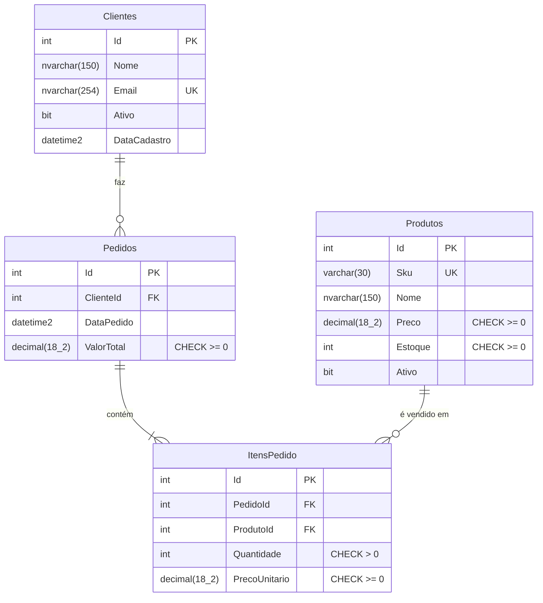

# Especificação — Mini Gestão de Pedidos

> Status: **Aprovada para implementação** · Versão 1.0 · 2026-11-14
> Abordagem: Spec-Driven Development (SDD). Este documento é a fonte da verdade; o código e os testes
> referenciam os IDs de regra (`RN-xx`) e de critério de aceite (`CA-xx`) definidos aqui.

## 1. Objetivo

Permitir que um operador **cadastre pedidos de clientes** (com múltiplos itens), **consulte** os pedidos
com filtros e paginação e veja um **ranking dos 5 clientes** com maior valor comprado em um período.

### 1.1 Fora de escopo (v1)

- Autenticação/autorização de usuários (a API é interna; ver §8 Segurança para o que foi mitigado).
- Edição/cancelamento de pedidos (pedidos são **imutáveis** após criados).
- CRUD de clientes e produtos (vêm da carga inicial; a API só os expõe para leitura).
- Pagamento, frete, impostos, multi-moeda.

## 2. Glossário

| Termo | Definição |
|---|---|
| Pedido | Compra de um cliente, composta por 1..N itens, com data e valor total. |
| Item do pedido | Produto + quantidade + preço unitário **congelado** no momento da compra. |
| Estoque | Quantidade disponível de um produto. Baixado atomicamente na criação do pedido. |
| Período | Intervalo de datas `[dataInicio, dataFim]`, **inclusivo** nas duas pontas, em UTC. |

## 3. Regras de negócio

| ID | Regra |
|---|---|
| RN-01 | Um pedido deve ter **pelo menos 1 item** e no máximo **50 itens**. |
| RN-02 | O **cliente deve existir** e estar ativo. |
| RN-03 | Todo **produto deve existir** e estar ativo. |
| RN-04 | A **quantidade** de cada item deve ser inteira, entre **1 e 1000**. |
| RN-05 | Não é permitido repetir o mesmo produto em dois itens do mesmo pedido (o cliente deve somar a quantidade). |
| RN-06 | Deve haver **estoque suficiente** para todos os itens; se qualquer item falhar, **nenhum** estoque é baixado e o pedido não é criado (atomicidade). |
| RN-07 | O **preço unitário** é sempre o preço atual do produto no servidor — o cliente da API **não** envia preço. |
| RN-08 | O **valor total** do pedido é `Σ(quantidade × precoUnitario)`, calculado no servidor com `decimal(18,2)`. |
| RN-09 | A **data do pedido** é atribuída pelo servidor (UTC) no momento da criação. |
| RN-10 | A baixa de estoque deve ser segura sob **concorrência**: dois pedidos simultâneos nunca podem deixar o estoque negativo. |
| RN-11 | Listagem: ordenada por data decrescente (mais recente primeiro), desempate por `Id` decrescente. |
| RN-12 | Paginação: `page ≥ 1`, `1 ≤ pageSize ≤ 100`, padrão `page=1`, `pageSize=20`. |
| RN-13 | Filtros de período: `dataInicio ≤ dataFim`; ambos opcionais na listagem; **obrigatórios** no relatório. |
| RN-14 | Relatório top clientes: 5 clientes com maior soma de `ValorTotal` no período; desempate por menor `ClienteId` (determinístico). Clientes sem pedidos no período não aparecem. |
| RN-15 | Período máximo aceito pelo relatório: 366 dias × 5 (≈ 5 anos), para proteger o banco de varreduras abusivas. |

## 4. Modelo de dados (SQL Server)



### 4.1 Índices

| Índice | Motivo |
|---|---|
| `UX_Clientes_Email` (único) | Integridade (e-mail único). |
| `UX_Produtos_Sku` (único) | Integridade (SKU único). |
| `IX_Pedidos_ClienteId_DataPedido (ClienteId, DataPedido DESC) INCLUDE (ValorTotal)` | Listagem filtrada por cliente + período; cobre o FK `ClienteId`. |
| `IX_Pedidos_DataPedido (DataPedido DESC) INCLUDE (ClienteId, ValorTotal)` | Listagem só por período e relatório top-clientes (índice de cobertura → sem lookup). |
| `UX_ItensPedido_PedidoId_ProdutoId (PedidoId, ProdutoId) INCLUDE (Quantidade, PrecoUnitario)` | Garante RN-05 no banco, cobre o FK `PedidoId` e as somas por pedido (Parte 4). |
| `IX_ItensPedido_ProdutoId` | Cobre o FK `ProdutoId` (SQL Server não indexa FKs automaticamente). |

### 4.2 Decisões de modelagem

- `ValorTotal` é **desnormalizado** em `Pedidos`. Justificativa: pedidos são imutáveis (fora de escopo editar),
  então o total nunca diverge dos itens; listagem e relatório viram leituras de um único índice de cobertura.
  A consistência é garantida por gravar pedido + itens na **mesma transação** (teste de integração verifica).
- Chaves `INT IDENTITY`: volume esperado é pequeno; mais legíveis em logs/URLs. `BIGINT` seria trivial de adotar.
- Datas em `DATETIME2(0)` UTC.
- `ON DELETE CASCADE` apenas `Pedidos → ItensPedido`; Clientes/Produtos usam `NO ACTION` (não se apaga histórico).
- O schema é dono dos **scripts SQL** em `database/` (requisito), e não de migrations do EF. O EF Core apenas mapeia.

## 5. API REST

Base URL: `http://localhost:5080` (direto) ou `http://localhost:8080/api` (via frontend/nginx).
Formato: JSON (camelCase). Erros: [RFC 9457 Problem Details](https://www.rfc-editor.org/rfc/rfc9457) com
campo extra `code` estável para o frontend tratar.

### 5.1 `POST /pedidos` — cria um pedido

Request:
```json
{
  "clienteId": 1,
  "itens": [
    { "produtoId": 3, "quantidade": 2 },
    { "produtoId": 7, "quantidade": 1 }
  ]
}
```

Respostas:

| Status | Quando | `code` |
|---|---|---|
| `201 Created` + header `Location: /pedidos/{id}` | Sucesso. Corpo = `PedidoDetalheResponse`. | — |
| `400 Bad Request` | Corpo inválido: sem itens (RN-01), >50 itens, quantidade fora do intervalo (RN-04), produto repetido (RN-05), ids ≤ 0. Corpo com `errors` por campo. | `VALIDACAO` |
| `422 Unprocessable Entity` | Cliente inexistente/inativo (RN-02). | `CLIENTE_NAO_ENCONTRADO` |
| `422 Unprocessable Entity` | Produto inexistente/inativo (RN-03). | `PRODUTO_NAO_ENCONTRADO` |
| `409 Conflict` | Estoque insuficiente (RN-06/RN-10). `detail` lista produto, solicitado e disponível. | `ESTOQUE_INSUFICIENTE` |
| `429 Too Many Requests` | Rate limit excedido. | — |

`PedidoDetalheResponse`:
```json
{
  "id": 1024,
  "clienteId": 1,
  "clienteNome": "Ana Souza",
  "dataPedido": "2026-11-14T13:05:00Z",
  "valorTotal": 259.80,
  "itens": [
    { "produtoId": 3, "produtoNome": "Teclado", "quantidade": 2, "precoUnitario": 99.90, "subtotal": 199.80 }
  ]
}
```

> **Por que 422 vs 409?** 400 = o JSON não respeita o contrato; 422 = o contrato está ok mas referencia algo
> que não existe; 409 = conflito com o **estado atual** do recurso (estoque), que pode mudar se repetido depois.

### 5.2 `GET /pedidos/{id}` — detalhe (suporte ao `Location` do POST)

`200` com `PedidoDetalheResponse` · `404` se não existir.

### 5.3 `GET /pedidos` — lista com filtros e paginação

Query: `clienteId?`, `dataInicio?` (`yyyy-MM-dd`), `dataFim?` (`yyyy-MM-dd`), `page=1`, `pageSize=20`.

```json
{
  "items": [
    { "id": 1024, "clienteId": 1, "clienteNome": "Ana Souza",
      "dataPedido": "2026-11-14T13:05:00Z", "quantidadeItens": 2, "valorTotal": 259.80 }
  ],
  "page": 1, "pageSize": 20, "totalItems": 137, "totalPages": 7
}
```

`400` para `page < 1`, `pageSize` fora de `[1,100]`, `dataInicio > dataFim`.

### 5.4 `GET /relatorios/top-clientes` — top 5 por valor

Query: `dataInicio` e `dataFim` obrigatórios (RN-13, RN-15).

```json
[
  { "posicao": 1, "clienteId": 4, "clienteNome": "Bruno Lima", "quantidadePedidos": 31, "valorTotal": 18234.50 }
]
```

### 5.5 Endpoints de apoio (leitura, usados pelo frontend)

- `GET /clientes` → `[{ id, nome, email }]` (apenas ativos, ordenados por nome)
- `GET /produtos` → `[{ id, sku, nome, preco, estoque }]` (apenas ativos)
- `GET /health` → `200 Healthy` quando a API e o banco respondem.

## 6. Frontend

| Tela | Requisitos |
|---|---|
| Listagem de pedidos | Tabela (id, cliente, data, nº itens, total). Filtros: cliente (select), data início, data fim. Paginação (anterior/próxima, tamanho de página). Estados de carregando / vazio / erro. Filtros refletidos na URL (link compartilhável). |
| Modal "Novo pedido" | Seleciona cliente; adiciona N linhas de produto + quantidade; mostra preço, estoque disponível, subtotal e total em tempo real; impede produto repetido; valida no cliente (mesmas regras do backend) e exibe erros do backend (`code`) de forma amigável. Ao salvar: fecha, exibe confirmação e atualiza a listagem. |
| Painel Top clientes | Ranking do período selecionado na listagem (extra, consome o relatório). |

## 7. Requisitos não funcionais

| ID | Requisito |
|---|---|
| RNF-01 | `docker compose up` sobe banco (com scripts executados), API e frontend **sem passos manuais**. |
| RNF-02 | `GET /pedidos` p95 < 200 ms com 20k pedidos na base, 50 usuários virtuais (validado com k6). |
| RNF-03 | Logs estruturados; nenhum stack trace exposto ao cliente fora de Development. |
| RNF-04 | API roda como usuário não-root no container; banco acessado com login de **menor privilégio** (não `sa`). |
| RNF-05 | CI executa build, testes unitários, de integração (SQL Server real) e E2E a cada push/PR. |

## 8. Segurança (resumo; detalhes no README)

- Todas as consultas são parametrizadas (EF Core) — sem concatenação de SQL.
- Limites de entrada (RN-01, RN-04, RN-12, RN-15) e tamanho máximo de corpo protegem contra abuso.
- Rate limiting no `POST /pedidos` (fixed window por IP).
- CORS restrito à origem do frontend; nginx com headers de segurança (CSP, `X-Content-Type-Options`, `frame-ancestors`).
- Login SQL da aplicação com `db_datareader` + `db_datawriter` apenas; login do MCP **somente leitura**.
- Segredos via variáveis de ambiente (`.env`, não versionado); valores padrão só para avaliação local.

## 9. Critérios de aceite

Formato Given/When/Then. Cada critério tem pelo menos um teste automatizado (coluna "Teste").

| ID | Critério | Teste |
|---|---|---|
| CA-01 | **Dado** cliente e produtos válidos com estoque, **quando** POST /pedidos, **então** 201, `Location` aponta para o pedido, total = Σ itens e o estoque de cada produto é reduzido. | Integração |
| CA-02 | **Dado** pedido sem itens, **então** 400 `VALIDACAO` com erro em `itens`. | Unit + Integração |
| CA-03 | **Dado** cliente inexistente, **então** 422 `CLIENTE_NAO_ENCONTRADO` e nada é gravado. | Unit + Integração |
| CA-04 | **Dado** produto inexistente, **então** 422 `PRODUTO_NAO_ENCONTRADO`. | Unit |
| CA-05 | **Dado** quantidade maior que o estoque em qualquer item, **então** 409 `ESTOQUE_INSUFICIENTE` e **nenhum** estoque é alterado. | Unit + Integração |
| CA-06 | **Dado** quantidade ≤ 0 ou > 1000, ou produto repetido, **então** 400. | Unit |
| CA-07 | **Dado** produto com estoque 5 e 20 requisições simultâneas de 1 unidade, **então** exatamente 5 retornam 201, 15 retornam 409 e o estoque final é 0. | Integração |
| CA-08 | **Dado** preço enviado pelo cliente (campo extra), **então** é ignorado; vale o preço do cadastro. | Unit |
| CA-09 | **Dado** filtros de cliente e período, **quando** GET /pedidos, **então** só retornam pedidos daquele cliente no período (datas inclusivas), ordenados por data desc. | Integração |
| CA-10 | **Dado** 25 pedidos e `pageSize=10`, **então** `page=3` retorna 5 itens, `totalPages=3`. | Integração |
| CA-11 | **Dado** `pageSize=500` ou `dataInicio > dataFim`, **então** 400. | Unit + Integração |
| CA-12 | **Dado** pedidos de vários clientes no período, **quando** GET /relatorios/top-clientes, **então** retorna no máximo 5, ordenados por valor desc, ignorando pedidos fora do período. | Integração |
| CA-13 | **Dado** relatório sem `dataInicio`/`dataFim`, **então** 400. | Integração |
| CA-14 | **Dado** o frontend aberto, **quando** o usuário cria um pedido no modal, **então** o pedido aparece no topo da listagem. | E2E (Playwright) |
| CA-15 | **Dado** `docker compose up` numa máquina limpa, **então** a aplicação fica acessível em `http://localhost:8080` com dados de exemplo. | CI (job E2E) |
